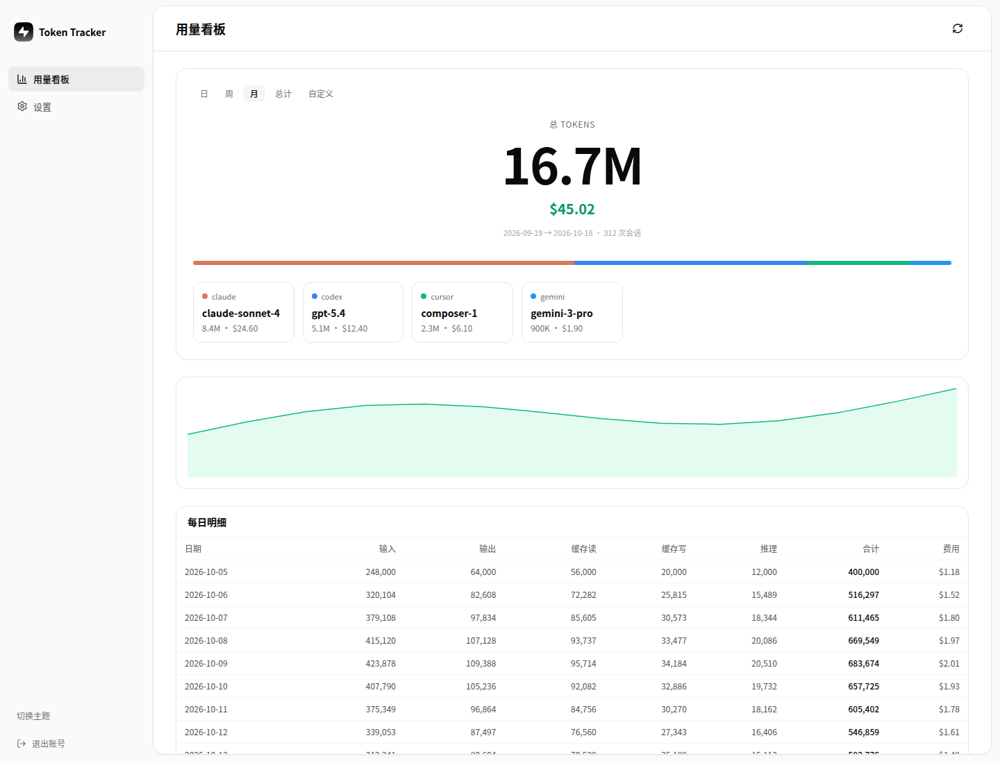

# Token Pulse

本地采集 AI 编码工具的 token 用量，上传到 Vercel 上的 PostgreSQL，并在用量看板查看。不会上传提示词或消息正文。单用户设计：一个环境变量密钥即可鉴权，没有账号体系。

[](https://vercel.com/new/clone?repository-url=https%3A%2F%2Fgithub.com%2FSunXin121%2FTokenPulse&project-name=token-pulse&repository-name=token-pulse&env=ACCESS_KEY&envDescription=Your%20access%20key%20-%20the%20single%20shared%20secret%20for%20uploads%20and%20the%20dashboard.%20Server-only%3A%20never%20prefix%20it%20with%20VITE_.%20The%20database%20is%20attached%20afterwards%20via%20Vercel%20Storage%20%28it%20injects%20DATABASE_URL%20automatically%29.&envLink=https%3A%2F%2Fgithub.com%2FSunXin121%2FTokenPulse%2Fblob%2Fmain%2Fdocs%2FVERCEL.md)
[](https://www.npmjs.com/package/token-pulse)



## 快速开始

### 1. 部署服务端

点上面的 **Deploy with Vercel**，或按 [部署说明](docs/VERCEL.md) 手动部署。按钮会把仓库克隆到你自己的 GitHub 账号、按 `vercel.json` 建好 Vercel 项目，并要求填写一个仅服务端使用的环境变量：

- `ACCESS_KEY` —— 你的私有访问密钥，任意非空字符串均可。上传和看板都用这一个密钥鉴权。

数据库不需要设环境变量：部署完成后，在项目的 **Storage** 页签挂一个 PostgreSQL 数据库（Neon 或任意 Vercel Postgres 集成），Vercel 会自动注入 `DATABASE_URL`。然后对该数据库执行一次初始化：

```bash
psql "$DATABASE_URL" -f server/schema.sql   # 也可以把 server/schema.sql 贴进 SQL 编辑器执行
```

没有账号体系、也不需要在数据库里建任何账号 —— 换密钥只需要改环境变量。

### 2. 用 npx 安装采集端

```bash
npx token-pulse@latest init --yes
npx token-pulse@latest connect --api-url https://你的项目.vercel.app --key <your key>
npx token-pulse@latest sync
```

`init` 会把一份自包含运行时（`bin` + `src` + 运行期依赖）复制到 `~/.token-pulse/app`，并写入无第三方依赖的 `~/.token-pulse/bin/notify.cjs`；各 provider 钩子因此直接运行 `node ~/.token-pulse/app/bin/token-pulse.js`，不依赖 npx 缓存（只有该副本缺失时才回退到 `npx --yes token-pulse sync --auto`）。不需要全局安装。想常驻一个命令就 `npm i -g token-pulse`，之后去掉 `npx` 前缀（`token-pulse init --yes` 等）。

`connect` 把上传目标写入 `~/.token-pulse/tracker/upload.json`（权限 600），后台 hook 因此无需修改 shell 配置即可上传；采集端的 `TOKEN_PULSE_API_URL` / `TOKEN_PULSE_ACCESS_KEY` 仍可按次覆盖。`sync` 采集并上传，`upload` 重放已有本地记录，`status` 查看队列/积压/上传诊断。

### 3. 打开看板

打开部署站点，输入同一个访问密钥 —— 浏览器只把它放在 session storage 里。

## 更新与自动化

| 触发 | 执行内容 |
|---|---|
| push 到 `main` | Vercel Git 集成自动重新部署服务端（同时 `.github/workflows/ci.yml` 跑测试） |
| 推送 `v*` tag | `.github/workflows/publish-npm.yml` —— `npm publish`，`npx token-pulse@latest` 随即取到新版本 |

在 Vercel 后台导入一次 GitHub 仓库（New Project → Import，`vercel.json` 的配置自动生效），之后每次 push 到 `main` 都会自动部署。发布工作流需要 `NPM_TOKEN` secret —— 没配置时任务只打一条 notice 并跳过，fork 不会因此变红。细节见 [docs/VERCEL.md](docs/VERCEL.md)。

验证：`npm ci && npm ci --prefix dashboard && npm run ci:local`。端到端测试使用内存 PostgreSQL 引擎，不连接生产数据库。
